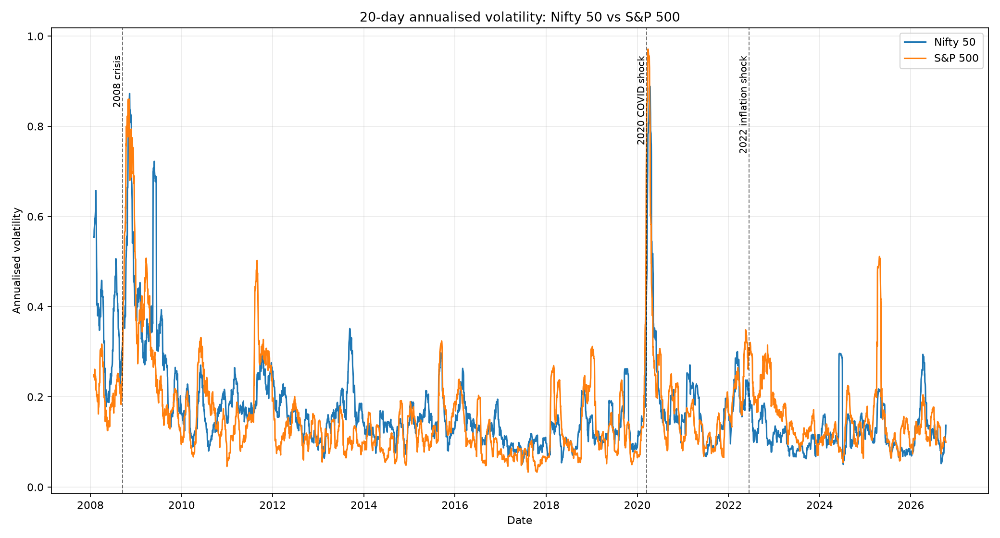
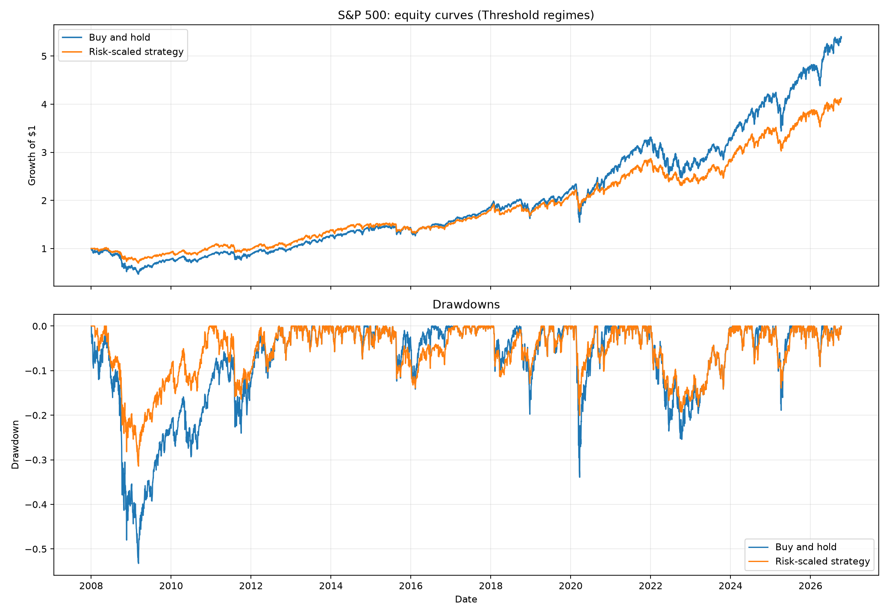

# Market Risk Monitor: Volatility Regime Detection and Risk-Scaled Position Sizing

This project classifies daily market conditions into volatility regimes and tests whether reducing exposure during turbulent periods can reduce drawdowns without destroying risk-adjusted returns.

## Phase 0: Setup

### Finance Concept

Markets are not equally risky every day. Some periods feel like a calm road, where prices move gently, while others feel like driving through heavy rain, where sudden moves are more likely. This project will measure that changing risk using volatility, then use those regimes to decide when a strategy should take less exposure. The key idea is not to predict the market perfectly, but to avoid taking the same amount of risk when conditions are clearly more dangerous.

### Project Structure

```text
market-risk-monitor/
  data/                cached market data CSV files
  src/
    data_loader.py     download, cache, and clean prices
    features.py        returns and rolling volatility
    regimes.py         threshold and K-Means regime labels
    backtest.py        strategy engine, costs, and equity curves
    metrics.py         performance and risk metrics
  notebooks/
    analysis.ipynb     exploration and narrative
  app/
    dashboard.py       Streamlit dashboard
  tests/               unit tests
  README.md
  requirements.txt
```

### Environment Setup

From inside the `market-risk-monitor` folder:

```powershell
python -m venv .venv
.\.venv\Scripts\Activate.ps1
python -m pip install --upgrade pip
pip install -r requirements.txt
```

If PowerShell blocks activation scripts, run this once in the same terminal:

```powershell
Set-ExecutionPolicy -ExecutionPolicy RemoteSigned -Scope CurrentUser
```

Then activate the environment again.

### How We Will Run Things Later

```powershell
pytest
streamlit run app/dashboard.py
```

The project will download data once using `yfinance`, save it under `data/`, and then reuse the cached CSV files so later runs work offline.

## Phase Status

- Phase 0: complete
- Phase 1: complete
- Phase 2: complete
- Phase 3: complete
- Phase 4: complete
- Phase 5: complete
- Phase 6: complete
- Phase 7: complete

## Phase 1: Data and Basics

### Finance Concept

A daily return measures the market's one-day percentage move, like checking how far one step moved you rather than how far the whole journey has gone. Volatility measures how jumpy those daily steps are: a calm market takes small, steady steps, while a turbulent market lurches around. A 20-day rolling volatility uses about one trading month of recent returns to estimate current market roughness. Annualised volatility scales that daily roughness into a yearly-style number, which makes different markets easier to compare.

### What Was Built

- Downloaded daily Nifty 50 (`^NSEI`) and S&P 500 (`^GSPC`) data with `yfinance`
- Cached raw CSV files under `data/`
- Built daily return and 20-day annualised volatility features
- Saved feature CSV files under `data/`
- Generated the first volatility chart with annotations for 2008, 2020, and 2022

### Phase 1 Results

These figures were generated by running `python scripts/run_phase1.py`.

| Market | Rows | Date range | Return points | Volatility points | Latest 20-day annualised volatility |
| --- | ---: | --- | ---: | ---: | ---: |
| Nifty 50 | 4,605 | 2008-01-01 to 2026-10-09 | 4,604 | 4,585 | 13.70% |
| S&P 500 | 4,723 | 2008-01-02 to 2026-10-09 | 4,722 | 4,703 | 9.95% |



### How to Reproduce Phase 1

```powershell
python scripts/run_phase1.py
```

The first run downloads data. Later runs use the cached CSV files unless the script is changed to force a fresh download.

## Phase 2: Regime Labelling

### Finance Concept

A volatility regime is a simple label for the market's current risk environment: Low, Medium, or High. The threshold method is like using fixed weather rules: below one cutoff is calm, above another cutoff is stormy. K-Means is more like letting the data form three natural groups, then naming the lowest-volatility group Low and the highest-volatility group High. We fit both methods only on the training period, because using the full dataset would leak future information into past decisions.

### What Was Built

- Threshold regime labels using the 33rd and 67th volatility percentiles from training data only
- K-Means regime labels with `k=3`, fitted on training volatility only
- Cluster ordering by mean volatility so K-Means labels are stable: Low, Medium, High
- Agreement comparison between threshold and K-Means labels
- Labelled regime CSVs under `data/`

### Phase 2 Results

These figures were generated by running `python scripts/run_phase2.py`.

| Market | Train-fitted threshold cutoffs | K-Means cluster mapping | Overall agreement | Train agreement | Test agreement |
| --- | --- | --- | ---: | ---: | ---: |
| Nifty 50 | Low <= 12.94%, High > 18.23% | `{0: Low, 2: Medium, 1: High}` | 44.34% | 36.24% | 63.23% |
| S&P 500 | Low <= 10.26%, High > 17.10% | `{0: Low, 1: Medium, 2: High}` | 31.72% | 35.75% | 22.32% |

The methods do not agree very strongly. That is not automatically a failure: thresholds force roughly percentile-based buckets in the training set, while K-Means places boundaries where the volatility data clusters naturally. This difference is useful because it reminds us that regime labels are modelling choices, not objective facts.

### How to Reproduce Phase 2

```powershell
python scripts/run_phase2.py
```

Outputs:

- `data/nifty50_regimes.csv`
- `data/sp500_regimes.csv`
- `reports/phase2_nifty50_agreement.csv`
- `reports/phase2_sp500_agreement.csv`

## Phase 3: Regime Analysis

### Finance Concept

After labelling regimes, we test whether those labels actually describe different market behaviour. Mean return shows the average daily move, volatility shows how unstable those moves are, worst day captures the single largest daily loss, and 5% VaR estimates a bad-loss threshold. VaR is like saying: "on 5 out of 100 similar days, losses were worse than this." Regime persistence checks whether today's regime tends to continue tomorrow, which is important because volatility often clusters instead of disappearing immediately.

### What Was Built

- Per-regime mean return, annualised volatility, worst day, 5% VaR, share of days, and day count
- Regime persistence, measured as the probability that the next labelled day remains in the same regime
- Phase 3 CSV outputs under `reports/`
- Plain-English insights saved to `reports/phase3_insights.txt`

### Phase 3 Results

These figures were generated by running `python scripts/run_phase3.py`.

| Market | Method | Low regime vol | High regime vol | High regime worst day | High regime 5% VaR | High persistence |
| --- | --- | ---: | ---: | ---: | ---: | ---: |
| Nifty 50 | Threshold | 10.26% | 31.98% | -12.98% | -3.10% | 95.08% |
| Nifty 50 | K-Means | 13.99% | 65.40% | -12.98% | -5.23% | 94.23% |
| S&P 500 | Threshold | 8.45% | 30.95% | -11.98% | -3.07% | 96.24% |
| S&P 500 | K-Means | 12.32% | 73.85% | -11.98% | -8.27% | 97.78% |

### Plain-English Insights

- High-volatility regimes have much larger realised volatility than Low regimes across both markets and both labelling methods.
- The worst daily losses occurred in High regimes, which supports the idea that high volatility is strongly linked to downside risk.
- K-Means creates a much smaller but more extreme High regime than the threshold method, especially for the S&P 500.
- High-regime persistence is above 94% in every case, showing clear volatility clustering.
- Mean daily returns do not consistently fall in High regimes, so the main benefit of regime detection is risk control rather than return prediction.

### How to Reproduce Phase 3

```powershell
python scripts/run_phase3.py
```

Outputs include:

- `reports/phase3_nifty50_threshold_regime_summary.csv`
- `reports/phase3_nifty50_kmeans_regime_summary.csv`
- `reports/phase3_sp500_threshold_regime_summary.csv`
- `reports/phase3_sp500_kmeans_regime_summary.csv`
- `reports/phase3_insights.txt`

## Phase 4: Strategy Backtest

### Finance Concept

A backtest simulates how a strategy would have performed historically. Buy-and-hold keeps full exposure every day, while the risk-scaled strategy uses full exposure in Low and Medium regimes and half exposure in High regimes. Drawdown measures the fall from a previous portfolio peak, which is useful because investors often care about how deep the losing periods become. Sharpe ratio compares return with volatility, and transaction costs are subtracted because changing exposure is not free in real markets.

### What Was Built

- Buy-and-hold baseline
- Risk-scaled strategy with position `1.0` in Low/Medium regimes and `0.5` in High regimes
- No-lookahead position sizing: today's position uses the previous day's regime
- Transaction costs of `0.1%` per unit of position change
- CAGR, annualised volatility, Sharpe ratio, max drawdown, worst day, and win rate
- Equity curve and drawdown charts under `reports/figures/`

### Phase 4 Results

These figures were generated by running `python scripts/run_phase4.py`.

| Market | Regime method | Strategy | CAGR | Ann. vol | Sharpe | Max drawdown | Worst day |
| --- | --- | --- | ---: | ---: | ---: | ---: | ---: |
| Nifty 50 | Threshold | Buy and hold | 7.37% | 20.29% | 0.45 | -59.86% | -12.98% |
| Nifty 50 | Threshold | Risk-scaled | 5.79% | 14.24% | 0.47 | -31.86% | -6.49% |
| Nifty 50 | K-Means | Buy and hold | 7.37% | 20.29% | 0.45 | -59.86% | -12.98% |
| Nifty 50 | K-Means | Risk-scaled | 8.85% | 18.52% | 0.55 | -45.67% | -8.30% |
| S&P 500 | Threshold | Buy and hold | 9.41% | 19.81% | 0.55 | -53.25% | -11.98% |
| S&P 500 | Threshold | Risk-scaled | 7.85% | 13.32% | 0.63 | -31.43% | -5.99% |
| S&P 500 | K-Means | Buy and hold | 9.41% | 19.81% | 0.55 | -53.25% | -11.98% |
| S&P 500 | K-Means | Risk-scaled | 10.15% | 17.86% | 0.63 | -45.88% | -9.51% |



### Interpretation

- The threshold strategy cut max drawdown sharply for both markets, but it also reduced CAGR because it spent more time at half exposure.
- The K-Means strategy improved CAGR and Sharpe in this Phase 4 run, but its drawdown reduction was smaller than the threshold strategy.
- Worst-day losses improved in every risk-scaled case because the strategy was partially de-risked during high-volatility periods.
- This is not yet enough to claim the strategy is robust, because Phase 5 still needs out-of-sample validation and sensitivity checks.

### How to Reproduce Phase 4

```powershell
python scripts/run_phase4.py
```

Outputs include:

- `reports/phase4_nifty50_threshold_regime_metrics.csv`
- `reports/phase4_nifty50_kmeans_regime_metrics.csv`
- `reports/phase4_sp500_threshold_regime_metrics.csv`
- `reports/phase4_sp500_kmeans_regime_metrics.csv`
- `reports/figures/phase4_nifty50_threshold_regime.png`
- `reports/figures/phase4_sp500_threshold_regime.png`

## Phase 5: Out-of-Sample Validation

### Finance Concept

Out-of-sample validation checks whether the strategy works on data that was not used to fit the regime rules. This matters because a model can accidentally learn the quirks of the past rather than something useful about markets. Overfitting is like memorising one old exam paper: it feels powerful until the questions change. Sensitivity checks then ask whether the result survives reasonable parameter changes, such as using 10, 20, or 60-day volatility windows and different High-regime exposure cuts.

### What Was Built

- Train/test split using the first 70% of labelled dates for fitting and the last 30% for validation
- Train-only threshold and K-Means fitting, then unchanged application to test data
- Train/test metrics side by side for the default setup: 20-day volatility window, 50% High-regime exposure, and 0.1% transaction cost
- Sensitivity grid across volatility windows `10/20/60` and High-regime exposures `0.25/0.50/0.75`
- Honest assessment file summarising where the strategy helped and where it did not

### Default Train/Test Results

These figures were generated by running `python scripts/run_phase5.py`.

| Market | Method | Split | Strategy | CAGR | Ann. vol | Sharpe | Max drawdown |
| --- | --- | --- | --- | ---: | ---: | ---: | ---: |
| Nifty 50 | Threshold | Train | Buy and hold | 8.51% | 22.14% | 0.48 | -53.97% |
| Nifty 50 | Threshold | Train | Risk-scaled | 6.21% | 15.06% | 0.48 | -31.86% |
| Nifty 50 | Threshold | Test | Buy and hold | 7.85% | 13.77% | 0.62 | -17.23% |
| Nifty 50 | Threshold | Test | Risk-scaled | 4.93% | 12.23% | 0.45 | -20.83% |
| Nifty 50 | K-Means | Test | Buy and hold | 7.85% | 13.77% | 0.62 | -17.23% |
| Nifty 50 | K-Means | Test | Risk-scaled | 7.85% | 13.77% | 0.62 | -17.23% |
| S&P 500 | Threshold | Train | Buy and hold | 8.10% | 21.05% | 0.48 | -52.58% |
| S&P 500 | Threshold | Train | Risk-scaled | 6.64% | 13.63% | 0.54 | -31.43% |
| S&P 500 | Threshold | Test | Buy and hold | 13.21% | 16.51% | 0.86 | -25.43% |
| S&P 500 | Threshold | Test | Risk-scaled | 10.38% | 12.68% | 0.87 | -19.31% |
| S&P 500 | K-Means | Test | Buy and hold | 13.21% | 16.51% | 0.86 | -25.43% |
| S&P 500 | K-Means | Test | Risk-scaled | 13.21% | 16.51% | 0.86 | -25.43% |

### Sensitivity Results

Across all sensitivity cases:

| Split | Drawdown improved | Sharpe improved | CAGR improved |
| --- | ---: | ---: | ---: |
| Train | 100% | 75% | 42% |
| Test | 33% | 25% | 0% |

Average test effect across sensitivity cases:

- Max drawdown improved by about 1.11 percentage points.
- Sharpe decreased by about 0.01 on average.
- CAGR decreased by about 0.98 percentage points on average.

### Honest Assessment

The strategy is useful as a risk-control framework, but it is not a magic return enhancer. In training data, it consistently reduced drawdowns and often improved Sharpe. In test data, drawdown reduction was mixed, CAGR did not improve across the sensitivity grid, and Sharpe improvement was inconsistent. The K-Means default test result did almost nothing because its test-period High regime was rarely triggered under the fitted cluster rules. So the honest conclusion is: volatility regimes are informative for downside-risk management, but the simple position-sizing rule needs more validation before being treated as a trading edge.

### How to Reproduce Phase 5

```powershell
python scripts/run_phase5.py
```

Outputs include:

- `reports/phase5_nifty50_threshold_regime_train_test_metrics.csv`
- `reports/phase5_sp500_threshold_regime_train_test_metrics.csv`
- `reports/phase5_nifty50_sensitivity.csv`
- `reports/phase5_sp500_sensitivity.csv`
- `reports/phase5_sensitivity_all.csv`
- `reports/phase5_assessment.txt`

## Phase 6: Streamlit Dashboard

### Finance Concept

The dashboard turns the research pipeline into an interactive risk monitor. The current regime indicator acts like a market risk traffic light, while the volatility value shows how rough the recent market ride has been. Equity curves show how wealth would have grown under buy-and-hold versus risk-scaled exposure. Drawdown curves show the painful peak-to-trough periods, which is often the clearest way to compare risk.

### What Was Built

- Sidebar controls for index, regime method, volatility window, High-regime exposure, and transaction cost
- Price chart coloured by the selected volatility regime
- Current regime indicator with latest annualised volatility
- Buy-and-hold versus risk-scaled strategy equity curves
- Drawdown curves
- Performance metrics table
- Recent labelled rows for checking the data behind the dashboard
- Cached data pipeline so repeated dashboard interactions are faster

### How to Run the Dashboard

```powershell
streamlit run app/dashboard.py
```

Then open the local URL Streamlit prints, usually:

```text
http://localhost:8501
```

If port `8501` is already busy, Streamlit may choose another port such as `8502`. Use the exact URL printed in PowerShell.

### Dashboard Notes

- Signals are shifted by one day, so today's position uses yesterday's regime.
- Transaction costs are applied every time the strategy changes position.
- The dashboard recomputes regimes from train-fitted rules for the selected volatility window.
- The dashboard is interactive, so its numbers can differ from static README tables when controls are changed.

## Phase 7: Quality and Delivery

### What Was Built

- Unit tests for performance metrics
- Unit tests for regime labelling
- A lookahead-bias test confirming today's position uses yesterday's regime
- Final README sections for results, limitations, resume bullets, spoken explanations, interview prep, and glossary

### Test Results

```powershell
python -m pytest tests -q -p no:cacheprovider
```

Result:

```text
8 passed in 1.32s
```

The `-p no:cacheprovider` flag avoids writing pytest cache files in this OneDrive folder, where the existing `.pytest_cache` directory may be permission-locked.

## Resume and Interview Prep

### Resume Bullets

- Built a Python and Streamlit market risk monitor for Nifty 50 and S&P 500 using 4,605 and 4,723 daily observations respectively, with cached `yfinance` data, rolling volatility features, regime labelling, and an interactive dashboard.
- Implemented train-only Threshold and K-Means volatility regime models with no-lookahead backtesting, transaction costs, equity curves, drawdown curves, and out-of-sample validation.
- Found that risk-scaled exposure reduced training drawdown in 100% of sensitivity cases and test drawdown in 33% of cases, while test CAGR did not improve across the sensitivity grid, showing honest risk-control benefits without overstating return edge.

### 30-Second Explanation

I built a market risk monitor that classifies each day for Nifty 50 and S&P 500 into Low, Medium, or High volatility regimes. The project downloads and caches daily data, computes rolling annualised volatility, labels regimes using both percentile thresholds and K-Means, then tests a simple strategy that cuts exposure during High-volatility periods. The backtest uses yesterday's regime to avoid lookahead bias and includes transaction costs. The main finding is that volatility regimes are useful for understanding and controlling drawdown, but they do not reliably improve out-of-sample returns.

### 2-Minute Explanation

This project studies a practical risk-management question: markets move through calm and turbulent periods, so can we detect those periods and reduce exposure when risk is high? I used about 15 years of daily Nifty 50 and S&P 500 data from Yahoo Finance, cached it locally, and computed daily returns plus rolling annualised volatility.

I built two regime models. The first uses volatility percentiles from the training set to label days as Low, Medium, or High volatility. The second uses K-Means clustering on volatility and then orders the clusters by average volatility so the labels are consistent. I was careful that all fitted parameters come only from training data.

Then I analysed each regime by mean return, volatility, worst day, 5% VaR, and persistence. High-volatility regimes captured much worse tail losses, and regime persistence above 94% showed volatility clustering clearly. For the strategy test, buy-and-hold was the baseline. The risk-scaled strategy used full exposure in Low and Medium regimes and half exposure in High regimes, using the previous day's regime for today's position and subtracting transaction costs.

The results were mixed in a realistic way. In the full backtest, risk scaling often reduced volatility and drawdowns. But in out-of-sample sensitivity tests, drawdown improvement was inconsistent and CAGR did not improve. So my conclusion is not that this is a finished trading strategy, but that volatility regimes are useful for risk monitoring and position-sizing research.

### Likely Interview Questions

**1. What problem does this project solve?**  
It detects volatility regimes and tests whether reducing exposure during high-risk periods can reduce drawdown.

**2. Why use returns instead of prices?**  
Returns are scale-free, so Nifty 50 and S&P 500 can be compared despite different index levels.

**3. What is rolling volatility?**  
It is the standard deviation of recent returns over a moving window, scaled to an annual number.

**4. Why annualise volatility?**  
Annualising puts daily volatility on a market-standard yearly scale.

**5. What are the two regime methods?**  
Threshold percentiles and K-Means clustering, both fitted only on training data.

**6. Why fit thresholds only on training data?**  
Using future data would create lookahead bias and make the backtest unrealistic.

**7. Why reorder K-Means clusters?**  
Cluster numbers are arbitrary, so ordering by mean volatility makes labels consistently Low, Medium, and High.

**8. What is volatility clustering?**  
It is the tendency for high-volatility periods to persist rather than disappear immediately.

**9. What is VaR?**  
Value at Risk is a loss threshold; 5% VaR means only 5% of days were worse than that value.

**10. What is drawdown?**  
Drawdown is the percentage fall from a previous equity peak.

**11. How did you avoid lookahead bias?**  
The strategy uses the previous day's regime to set today's position.

**12. Why include transaction costs?**  
Changing exposure has trading friction, and ignoring it can overstate strategy performance.

**13. Did the strategy work?**  
It helped risk control more than returns. Test drawdown improved in 33% of sensitivity cases, while test CAGR improved in 0%.

**14. What was the biggest limitation?**  
The strategy is simple and only uses volatility; it does not model trend, valuation, macro data, or changing market microstructure.

**15. What would you improve next?**  
I would test walk-forward retraining, futures-specific data, different cost assumptions, and more robust position-sizing functions.

## Glossary

- **Annualised volatility:** Daily volatility scaled to a yearly number, commonly using `sqrt(252)`.
- **Backtest:** A historical simulation of how a rule-based strategy would have performed.
- **Buy-and-hold:** A baseline strategy that stays fully invested every day.
- **CAGR:** Compound annual growth rate; the smoothed annual return from start to end.
- **Drawdown:** The percentage fall from a previous portfolio peak.
- **Equity curve:** The growth path of an initial investment over time.
- **Exposure:** The fraction of capital allocated to the market.
- **High-volatility regime:** A period labelled as unusually turbulent by the regime model.
- **K-Means:** A clustering algorithm that groups observations into `k` similar clusters.
- **Lookahead bias:** A backtest error where future information is accidentally used in past decisions.
- **Max drawdown:** The worst peak-to-trough loss in an equity curve.
- **Mean return:** The average return over a set of days.
- **Out-of-sample validation:** Testing on data not used to fit the model.
- **Position sizing:** Choosing how much exposure to take.
- **Regime:** A market state such as Low, Medium, or High volatility.
- **Return:** The percentage change in price over a period.
- **Sharpe ratio:** Return per unit of volatility, usually annualised.
- **Sensitivity check:** Testing whether results survive reasonable parameter changes.
- **Transaction cost:** The cost paid when changing a trading position.
- **VaR:** Value at Risk; a threshold loss exceeded only a chosen percentage of the time.
- **Volatility:** A measure of how much returns fluctuate.
- **Volatility clustering:** The tendency for high-volatility or low-volatility periods to persist.
- **Win rate:** The share of days with positive returns.

## Interview Prep

**Q1. Why does a trading project need a virtual environment?**  
A virtual environment keeps this project's package versions isolated, so changes here do not break other Python projects on the same computer.

**Q2. Why cache downloaded market data?**  
Caching makes the project reproducible and usable offline after the first successful download. It also avoids repeatedly depending on a network call.

**Q3. Why define the project structure before writing the models?**  
A clear structure separates data loading, feature engineering, modelling, backtesting, and testing. That makes the project easier to debug, explain, and extend.

**Q4. Why use returns instead of raw prices for volatility?**  
Prices have different scales across markets, but percentage returns are comparable. A 1% move means the same relative move whether the index level is 5,000 or 50,000.

**Q5. Why annualise 20-day volatility?**  
Annualising converts short-window volatility into a common market convention. It does not mean we observed a full year; it means we scaled recent daily volatility to a yearly equivalent.

**Q6. What problem does caching solve?**  
It avoids redownloading data every run and lets the project keep working if the network or Yahoo Finance is temporarily unavailable.

**Q7. Why fit regime thresholds only on training data?**  
Because using future volatility to define today's regime would create lookahead bias. In real trading, future data is unavailable.

**Q8. Why reorder K-Means clusters by mean volatility?**  
K-Means cluster numbers are arbitrary. Ordering by average volatility makes cluster labels economically meaningful and reproducible as Low, Medium, and High.

**Q9. Is low agreement between threshold and K-Means bad?**  
Not necessarily. It means the two methods define regimes differently; the next phases test which labels are more useful for risk analysis and backtesting.

**Q10. What is 5% VaR?**  
It is a loss threshold where about 5% of days were worse. For example, a -3% VaR means 5% of comparable days lost more than 3%.

**Q11. What does regime persistence show?**  
It shows whether a regime tends to continue the next day. High persistence supports volatility clustering, where calm or turbulent conditions often last for stretches of time.

**Q12. Why can High regimes have positive average returns?**  
High volatility means bigger swings, not only negative swings. Risk can be higher even when the average return is not lower.

**Q13. Why use the previous day's regime for today's position?**  
Because today's return is only known after today ends. Shifting the signal by one day prevents lookahead bias.

**Q14. Why include transaction costs?**  
Every position change has friction in real trading. Ignoring costs can make a strategy look better than what could actually be traded.

**Q15. Why might lower drawdown come with lower CAGR?**  
Cutting exposure during risky periods also cuts exposure during rebounds. Risk control can reduce losses, but it can also reduce gains.

**Q16. Why is out-of-sample testing important?**  
It checks whether a rule learned from the past still works on later data. Without it, a strategy may just be overfit to history.

**Q17. What did Phase 5 show honestly?**  
The strategy helped drawdowns more reliably than returns. Test-period CAGR and Sharpe improvements were inconsistent.

**Q18. Why run sensitivity checks?**  
They show whether the idea depends on one lucky parameter choice. A robust idea should not collapse when reasonable settings change.

**Q19. What does the dashboard add beyond scripts?**  
It lets a reviewer change assumptions quickly and see how regime labels, performance, and drawdowns respond without editing Python files.

**Q20. Why include transaction cost as a dashboard control?**  
Costs are uncertain and vary by instrument. Making them configurable shows whether results depend on an unrealistically cheap trading assumption.

**Q21. Why show recent labelled rows?**  
They make the dashboard auditable. A reviewer can inspect the latest volatility, regime, position, and strategy return instead of trusting only charts.
